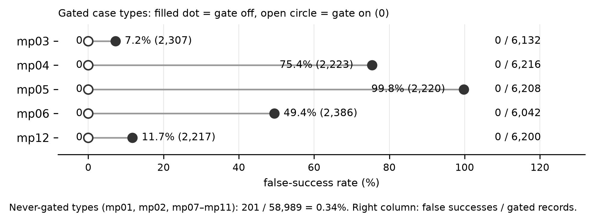

# Abstract

Tool-using artificial intelligence (AI) agents increasingly interact with operating systems, applications, and remote services through external tools. In these environments, an agent's statement that an operation has completed does not necessarily establish that the requested operation was successfully executed. Commands may fail, required programs or applications may be unavailable, and intermediary components may return misleading success messages. This creates a reliability problem in which reported execution outcomes can differ from observable system states.

This study evaluates an evidence-gated verification approach designed to distinguish reported execution success from independently observable execution evidence. The evaluation uses a heterogeneous, multi-region server fleet, a controlled cross-node cluster, and a EuroHPC LUMI-G (AMD MI250X) campaign, under two classes of conditions: honest execution and deliberately introduced false-success claims. The quantitative analysis is restricted to experiments for which raw machine-readable JSONL evidence records are available in the public benchmark archive and can be independently recounted.

Four raw-evidence conditions are reported. (A) The Vultr honest fleet produced **25,600 records across nine nodes with zero false-success records**. (B) The controlled Vultr liar condition produced **28,800 records across ten nodes, including 400 planted false-success records, all 400 flagged** by the verification pipeline (200 missing-program, 200 missing-application). (C) An independent controlled cross-node run on eight nodes produced 25,600 records with 24,000 success claims, of which 1,600 were false successes; the sibling run on four nodes produced 19,200 records with 1,200 false successes. (D) The LUMI-G campaign contributed **101,140 raw records over 24 run identifiers; the 30,798 records that carry the fail-closed gate flag contain zero false successes**, while the 70,342 unguarded model records contain 5,696 false successes (8.10%). Because the gate follows case type rather than record, the same five case types can be compared with and without it: they produce **5,495 false successes in 11,353 ungated records and none in 30,798 gated records**, and a matched pair of 10,000-record runs on the same model and day, with identical prompt hashes, gives 1,683 against 0. This comparison is quasi-experimental, not randomised (Section 5.5).

The results demonstrate successful detection of the planted false-success cases within the tested benchmark configuration, and a reproducible, case-matched separation between ungated and gated execution that a randomised design would still need to confirm. They do not establish universal detection performance, production failure prevalence, or resistance to all possible forms of adversarial behaviour. Every principal number in this paper is reproducible from the supplied JSONL records with a single script.

**Keywords:** artificial intelligence agents; tool execution; execution verification; evidence gating; false-success claims; distributed systems; multi-region infrastructure; benchmark reproducibility.

# 1. Introduction

AI agents increasingly perform operational tasks through external tools: executing shell commands, managing files, interacting with applications, deploying software, accessing APIs, and administering remote infrastructure. Their growing autonomy introduces a reliability challenge: an agent may report that an operation has been completed even when the requested action has not taken place.

A successful-looking response is not necessarily evidence of successful execution. An agent may report that a program was installed when the package manager failed, claim that an application was started when it was not installed, or report that a remote operation succeeded without reliable confirmation from the target system.

This creates a distinction between two concepts:

1. **Execution assertion** — a statement made by an agent or intermediary that an operation succeeded.
2. **Execution evidence** — independently observable information supporting the claim that the operation actually succeeded.

Systems that rely exclusively on execution assertions are vulnerable to false-success reporting. Evidence-gated verification addresses this by requiring execution claims to be supported by observable evidence before they are accepted as successful.

## 1.1. Research question

Can an evidence-gated verification pipeline reliably distinguish honest execution reports from deliberately introduced false-success claims in a controlled multi-region server environment, and can every reported number be independently recomputed from raw records?

## 1.2. Research objectives

- Evaluate the verification pipeline under normal execution conditions.
- Introduce controlled false-success scenarios.
- Measure the pipeline's ability to identify planted false-success events.
- Examine the reproducibility and evidential limitations of the available experimental records.

## 1.3. Scope of the study

The analysis includes only experiments for which raw JSONL evidence records are available in the public benchmark archive and can be independently recounted. Results available only through aggregate reports are excluded from the quantitative analysis. In this version (v1.2) the scope is expanded from the Vultr fleet to three additional raw-evidence sources that were published after v1.0: a controlled cross-node run (8 nodes) and its 4-node sibling, and the LUMI-G per-request campaign. Version 1.2 additionally corrects the interpretation of the LUMI-G comparison, which is descriptive rather than causal (Section 5.5).

This restriction is intentional. The objective is not to maximize the number of reported results, but to ensure that every principal quantitative finding can be traced to available experimental records.

# 2. Conceptual Background

## 2.1. The execution-assertion problem

Software monitoring frequently relies on return codes, logs, telemetry, and application responses. AI agents add a layer of natural-language descriptions of actions and outcomes. An agent can produce a convincing completion message without having completed the requested operation. The message may be syntactically valid and semantically plausible while being operationally incorrect:

```
Reported Success  !=  Verified Success
```

## 2.2. Evidence-gated verification

Evidence-gated verification requires that a successful execution claim be supported by evidence:

```
V(a) = 1  if sufficient evidence supports action a
V(a) = 0  otherwise
```

The model separates the agent's assertion from the verification process. This is especially relevant in autonomous systems, where a false-success response may propagate into subsequent decisions and operations.

## 2.3. Controlled false-success scenarios

The benchmark introduces deliberately false success claims to evaluate whether the verification system can identify situations in which an operation is reported as successful despite a missing required resource. Two task categories are examined: **P1 — missing program** and **P2 — missing application**.

# 3. Materials and Methods

## 3.1. Experimental data sources

Four raw-evidence sources are used. All are public, versioned, and carry file-level SHA-256 digests.

| ID | Condition | Raw file | Records |
|---|---|---|---|
| A | Vultr honest fleet | `vultr_honest_evidence.jsonl.gz` | 25,600 |
| B | Vultr controlled liar | `vultr_liar_evidence.jsonl.gz` | 28,800 |
| C | Controlled cross-node run (8 nodes) | `trust_evidence_25600.jsonl.gz` | 25,600 |
| C' | Controlled cross-node sibling (4 nodes) | `trust_evidence_19200.jsonl.gz` | 19,200 |
| D | LUMI-G campaign | `lumi_guard_model_101140.jsonl.gz` | 101,140 |

The dataset additionally contains a chained artifact of 12,344 claim-versus-truth records (`evidence_chained.jsonl`) protected by a per-record SHA-256 chain and a Merkle root (`eda02d9c…d11d2d`), verifiable offline with the supplied `tools/evidence.py`. It is used here for integrity verification, not as a separate condition, and no rate in this paper is computed over the 12,344 records.

**Provenance of the prompts.** All prompts in the campaign are synthetic: they were generated from task templates used in the authors' own operational tooling and contain no customer records, names, addresses, telephone numbers, or personal e-mail addresses. Internal schema identifiers (for example the database name `vp2026`) are retained verbatim, because they are part of the task text and removing them would change the prompt hashes. A scan of all 101,140 `text` fields returns six e-mail-shaped strings, all of them placeholders (`vase_kompanije_email@domena.com`, `vaša.e.posta@kompanija.com`, `vaša.kompanija@domena.co`), and no national identification numbers; the apparent telephone matches are shell `PATH` strings.

**Licences of the recorded outputs.** Outputs of Qwen2.5-7B and Mistral-Small-3.2-24B are redistributed under their Apache-2.0 terms. Outputs of Llama-3.3-70B-Instruct are redistributed under the Llama 3.3 Community License, with attribution to Meta and without any use of the outputs to train or improve another language model. Each record also carries `prompt_sha` and `text_len`, so a hash-and-length variant that omits raw text entirely can be generated from the archive without affecting any count reported here.

## 3.2. Infrastructure configuration

The Vultr fleet consisted of eight Ubuntu 24.04 instances distributed across Frankfurt (FRA), Amsterdam (AMS), London (LHR), Madrid (MAD), Newark (EWR), Chicago (ORD), Dallas (DFW), and Los Angeles (LAX), plus a Contabo server. The honest condition used nine nodes. The controlled dishonest condition added the node designated `vultr-lax-liar`, for ten nodes.

Condition C was executed on eight nodes with 16 tasks and 200 rounds; its sibling C' on four nodes with 300 rounds. Condition D ran on LUMI-G (4x AMD MI250X per node, ROCm) under the EuroHPC project EHPC-AIF-2026PG01-1844.

## 3.3. Experimental conditions

### 3.3.1. Condition A — honest execution

9 nodes, 16 tasks per round, 200 rounds. With 16 tasks per completed round this yields 25,600 records because not every node produced a record in every round: Contabo contributed 3,200 records (200 rounds x 16 tasks) and each of the eight Vultr nodes contributed 2,800 (175 x 16).

### 3.3.2. Condition B — controlled dishonest execution

10 nodes, 16 tasks per round, 200 rounds, 28,800 records: Contabo 3,200, eight Vultr nodes 2,800 each, and `vultr-lax-liar` 3,200. The controlled liar condition includes two categories of planted false-success events, P1 and P2, each contributing 200 false-success records.

### 3.3.3. Condition C — controlled cross-node run

Eight nodes, 16 tasks, 200 rounds, 25,600 records, of which 24,000 are success claims. The run contains a planted liar share; 1,600 records are flagged as false successes. The sibling run C' (four nodes, 300 rounds) produced 19,200 records, 18,000 claims, and 1,200 flagged false successes.

### 3.3.4. Condition D — LUMI-G per-request campaign

The campaign contains 101,140 per-request records over 24 run identifiers on three models (Qwen2.5-7B, Llama-3.3-70B-Instruct, Mistral-Small-3.2-24B). Each record carries a `harness.guard` flag. Records with the gate enabled form the guarded subset; the rest are unguarded model outputs.

The gate was enabled for five of the twelve case types — `mp03`, `mp04`, `mp05`, `mp06` and `mp12` — and disabled for the remaining seven (`mp01`, `mp02`, `mp07`, `mp08`, `mp09`, `mp10`, `mp11`). Assignment was a property of the case type within a run, not a per-record randomisation. In a fully gated run the five gated case types are therefore gated in their entirety and the other seven are not, which gives 4,167 gated records in a 10,000-record run (5/12 of the tasks), 2,084 in a 5,000-record run, 417 in a 1,000-record run and 84 in a 200-record run. Of the 24 runs, 15 are fully gated in this sense, three 1,000-record runs armed the gate on a subset of the five case types, and six runs (26,640 records) ran entirely without the gate. Because the same case types occur both with and without the gate, the campaign supports a case-level comparison across runs (Section 4.5); because the assignment is not randomised, that comparison remains quasi-experimental (Section 5.5).

## 3.4. Raw evidence processing

Records are stored in JSONL. Compressed files are decompressed and each non-empty line is parsed as one JSON object. A record is counted as a false success when its explicit `false_success` value is true; where that field is absent, the pair `claim_ok = true` and `truth_ok = false` is used. The reported figures are record counts, not counts of unique users, production incidents, or distinct real-world tasks.

The complete recount is implemented in `recount.py` (supplied) and reproduces every number below.

## 3.5. Evaluation metrics

- **N** — number of valid JSONL records.
- **F** — number of records with `false_success = true`.
- **D** — detected planted false-success records divided by total planted false-success records. This measures detection within the specific planted set; it is not a general sensitivity estimate.

# 4. Results

## 4.1. Overview

| Condition | Nodes | Records | Claims | False successes |
|---|---|---|---|---|
| A — Vultr honest | 9 | 25,600 | 25,200 | **0** |
| B — Vultr controlled liar | 10 | 28,800 | 28,400 | **400** |
| C — cross-node controlled | 8 | 25,600 | 24,000 | **1,600** |
| C' — cross-node sibling | 4 | 19,200 | 18,000 | **1,200** |
| D — LUMI-G (guarded subset) | — | 30,798 | — | **0** |
| D — LUMI-G (unguarded subset) | — | 70,342 | — | **5,696** |

Rows D split the LUMI-G campaign by `harness.guard`. They are subsets of the same 101,140 records, not separate experiments; the case-matched comparison that the paper relies on is in §4.5 (Tables 4.2 and 4.3).

## 4.2. Condition A — honest execution

The raw recount identified 25,600 records, 25,200 success claims, and **0 false successes (0%)** across nine nodes. Latency, taken from the per-record `ms` field, was p50 = 64.8 ms and p95 = 325.1 ms.

## 4.3. Condition B — controlled dishonest execution

The recount identified 28,800 records and **400 false successes, all on `vultr-lax-liar`**. The distribution is exactly 200 missing-program (P1) and 200 missing-application (P2) records. Latency was p50 = 171.3 ms and p95 = 332.7 ms.

## 4.4. Condition C — controlled cross-node run

The recount identified 25,600 records and 24,000 success claims; 1,600 records are false successes (6.67% of claims). The sibling run gives 19,200 records, 18,000 claims, and 1,200 false successes (6.67% of claims). Condition C is a controlled liars test: the rate is a property of the planted share, not a field estimate.

## 4.5. Condition D — LUMI-G gated versus unguarded records

Of the 101,140 records, **30,798 carry the fail-closed gate flag and none of them is a false success (0/30,798)**; the 70,342 unguarded records contain **5,696 false successes (8.10%)**. Table 4.1 lists ten of the 24 runs, chosen to span run size, model and outcome; the full inventory is in Appendix A.2, and no run was selected because of its result.

**Table 4.1.** Selected LUMI-G runs (all 24 in Appendix A.2).

| Run identifier | Model | Records | Gated | False successes | FS in gated subset |
|---|---|---|---|---|---|
| `lumi-20261104-020310` | Qwen2.5-7B | 10,000 | 4,167 | 0 | 0 |
| `lumi-20261110-031936` | Llama-3.3-70B | 10,000 | 4,167 | 0 | 0 |
| `lumi-20261110-002049` | Qwen2.5-7B | 10,000 | 4,167 | 1 | 0 |
| `lumi-20261104-111050` | Qwen2.5-7B | 10,000 | 4,167 | 1 | 0 |
| `lumi-20261104-013504` | Qwen2.5-7B | 1,000 | 250 | 7 | 0 |
| `lumi-20261104-015816` | Qwen2.5-7B | 1,000 | 417 | 0 | 0 |
| `lumi-20261103-145941` | Qwen2.5-7B | 1,000 | 0 | 197 (19.7%) | — |
| `lumi-20261103-151200` | Qwen2.5-7B | 10,000 | 0 | 2,347 | — |
| `lumi-20261109-223741` | Mistral-Small-3.2-24B | 200 | 84 | 99 (49.5%) | 0 |
| `lumi-20261109-233200` | Mistral-Small-3.2-24B | 200 | 84 | 99 (49.5%) | 0 |

The gate is a property of the case type within a run: five case types (`mp03`, `mp04`, `mp05`, `mp06`, `mp12`) are gated, seven (`mp01`, `mp02`, `mp07`–`mp11`) are not. Within a gated run the five gated case types are fully gated and the other seven fully unguarded; six runs (26,640 records) ran entirely without the gate, and three 1,000-record runs armed it on a subset of the five (Appendix A.3). This structure does not allow a record-level randomisation, but it does allow the same case types to be compared across runs, and that comparison is what Table 4.2 reports.

**Table 4.2.** Gate on/off by case type, whole campaign.

| Case type | Gate off: records | Gate off: false successes | Gate on: records | Gate on: false successes |
|---|---|---|---|---|
| `mp03` | 2,307 | 165 | 6,132 | 0 |
| `mp04` | 2,223 | 1,676 | 6,216 | 0 |
| `mp05` | 2,220 | 2,216 | 6,208 | 0 |
| `mp06` | 2,386 | 1,178 | 6,042 | 0 |
| `mp12` | 2,217 | 260 | 6,200 | 0 |
| **Gated case types, total** | **11,353** | **5,495 (48.4%)** | **30,798** | **0** |
| `mp01`, `mp02`, `mp07`–`mp11` (never gated) | 58,989 | 201 (0.34%) | — | — |

The five gated case types therefore produce 5,495 false successes in 11,353 ungated records and none in 30,798 gated records, while the seven case types that were never gated produce false successes at 0.34%. Figure 4.1 shows the same numbers as rates.



**Figure 4.1.** False-success rate by case type. Filled dot: gate off; open circle: gate on, which is zero in all 30,798 gated records. The right column gives false successes and gated records. The seven never-gated case types are not plotted: 201 in 58,989 records (0.34%).

The archive also contains a matched pair: two 10,000-record runs on the same model (Qwen2.5-7B), executed on the same day, with identical prompt hashes for all twelve case types — `lumi-20261104-011605` without the gate and `lumi-20261104-020310` with it. The first produced 1,683 false successes, the second none (Table 4.3).

**Table 4.3.** Matched 10,000-record pair (Qwen2.5-7B, 4 November 2026, identical `prompt_sha` per case).

| Case type | `…011605` (gate off): FS | `…020310` (gate on): FS |
|---|---|---|
| `mp03` | 56 | 0 |
| `mp04` | 663 | 0 |
| `mp05` | 829 | 0 |
| `mp06` | 2 | 0 |
| `mp12` | 132 | 0 |
| other seven | 1 | 0 |
| **Total (10,000 records each)** | **1,683** | **0** |

What the archive cannot establish is the counterfactual: whether a gated record would have become a false success had the gate not been armed. The ungated runs of the same case types are the closest available control, not a randomised one; Section 5.5 states what follows and what does not.

Two further interpretive points.

*First, no aggregate in this paper is a "0/10,000 under the gate" claim.* The two 10,000-record runs with zero false successes (`lumi-20261104-020310`, `lumi-20261110-031936`) contain 4,167 gated records each; their zero applies to the whole run. The gated denominator over the campaign is 30,798, and that is the number used.

*Second, the Mistral runs are answer-check failures, not observed tool-execution lies.* The two 200-record Mistral runs contribute 198 false successes, all in unguarded records (168 of their records are gated, with 0 false successes; 232 are unguarded, with 198), and all in the seven case types that were never gated. Their `false_note` values are the check categories `contains` (96), `exact` (68) and `refuse` (34): the pipeline compares the returned answer against the expected value, and the model's answer did not satisfy the comparison. The 49.5% is therefore sensitive to answer formatting and refusal behaviour under a fixed prompt set. It is reported for completeness and excluded from every cross-model statement in this paper.

The earlier figure of "36,550 requests under the gate" is not reproducible from the archived per-record `harness.guard` flags; it is withdrawn and replaced by the countable 30,798 gated records.

## 4.6. Detection performance

Condition B includes a simulated dishonest component (`MockLiar`) that emits the 400 planted false-success claims. Within that condition the pipeline flagged all planted records:

```
D = 400 / 400 = 1.00  (100%)
```

This is a detection result on a simulated liar with a known planted set, not a measurement on real autonomous agents: the component does not adapt to the verifier and does not attempt evasion. It must not be read as a sensitivity estimate for unconstrained agents.

Combined with Condition A (0 false successes on 25,600 honest records) and Condition D (0 false successes on 30,798 gated records, which form a distinct set of case types), the results are consistent with the intended behaviour of an evidence gate: ordinary execution records are not marked as false successes, while deliberately introduced false-success claims are flagged within the tested configuration.

## 4.7. Recount reproducibility

Every number in Sections 4.1–4.5 was produced by `recount.py` from the five raw files, without access to any server:

```
python3 recount.py \
  --honest vultr_honest_evidence.jsonl.gz \
  --liar   vultr_liar_evidence.jsonl.gz \
  --trust  trust_evidence_25600.jsonl.gz \
  --trust2 trust_evidence_19200.jsonl.gz \
  --lumi   lumi_guard_model_101140.jsonl.gz
```

The script prints the same JSON object that generated the tables in this paper (`recount_output.json`, supplied).

# 5. Discussion

## 5.1. Principal findings

The results support the effectiveness of evidence-gated verification against the specific false-success scenarios tested. The honest Vultr condition produced 25,600 records without false successes; the controlled liar condition produced 400 planted false successes, all flagged. The LUMI-G campaign adds a larger record base in which the five gated case types yield 5,495 false successes in 11,353 ungated records and none in 30,798 gated records, with a matched 10,000-record run pair giving 1,683 against 0. Because gating follows case type rather than per-record randomisation, the comparison controls for task composition but remains quasi-experimental and is not reported as an effect size (Section 5.5).

## 5.2. Implications for autonomous agents

Autonomous agents perform operations that affect infrastructure, deployments, data, and business processes. A false-success report can create a chain of subsequent errors: an agent reports a package installed; a second agent assumes availability; a configuration task runs against a nonexistent dependency; the resulting system state differs from the assumed one. Evidence-gated architecture reduces this risk by requiring observable confirmation before an execution claim is accepted, which matters especially in multi-agent systems where one agent's output becomes another's input.

## 5.3. Distributed infrastructure considerations

The experiments span geographically distributed infrastructure, across providers and across an HPC partition. This provides evidence that the benchmark executes in heterogeneous environments. It does not establish that geographic distribution itself improves or reduces verification accuracy, and the study does not isolate network latency, regional characteristics, or per-node performance.

## 5.4. Latency considerations

Median latency was 64.8 ms in the honest condition and 171.3 ms in the controlled dishonest condition. The conditions differ in fleet composition and include an additional mock liar component, so the difference cannot be attributed exclusively to the verification mechanism. A paired experiment with verification enabled and disabled on identical infrastructure would be required to estimate incremental overhead.

## 5.5. Gate assignment, case composition and what the comparison supports

In the LUMI-G campaign the gate follows case type within a run, and six runs ran entirely without it (Section 3.3.4). Three consequences follow.

1. **The record-level split is descriptive.** No false success occurs among the 30,798 gated records; this is recomputable from `harness.guard` and `false_success` in one pass.
2. **The case-level comparison controls for task composition.** Table 4.2 compares the same five case types with and without the gate (5,495/11,353 against 0/30,798), and Table 4.3 compares two 10,000-record runs on the same model, same day and identical prompt hashes (1,683 against 0). Case composition therefore does not explain the separation.
3. **The comparison is still quasi-experimental.** Runs differ in time, execution order and unrecorded configuration besides the gate, and the archive contains no record of a gated run being re-executed with the gate disarmed. A randomised or paired on/off design — same run, same seeds, gate toggled — is the experiment that would estimate the gate's effect, and it is the first item of planned work. The claims in this paper do not depend on that estimate.

A second caution concerns the gated case types themselves: they are the five case types in which the outcome is checkable against an expected value, which is also why they are the ones where a gate can be armed. The seven never-gated case types produce false successes at 0.34% (201 in 58,989 records), so the concentration of false successes in the five gated case types (48.4% without the gate) is a property of the task family as much as of the gate.

The same caution applies to model comparisons. Qwen2.5-7B, Llama-3.3-70B and Mistral-Small-3.2-24B are not observed on the same mix of case types in equal proportion (the Mistral runs are 200 records each and never gated), so per-model rates should not be compared across models without conditioning on case type.

# 6. Limitations and Threats to Validity

1. **Controlled environment.** The dishonest conditions use mock liar components; they do not represent an unconstrained adversarial agent adapting to the verifier.
2. **Limited failure categories.** Only missing-program and missing-application scenarios are planted. Partial execution, stale state, permission errors, network failures, and manipulated telemetry were not evaluated.
3. **Zero is not proof of zero.** The absence of false successes in honest and gated sets establishes only that none were observed in those records.
4. **Configuration differences.** Fleet sizes differ between conditions; latency comparisons are not isolated measurements of verification overhead.
5. **Integrity.** The Vultr JSONL files do not carry a per-record hash chain; the chained artifact covers a separate 12,344-record set. File-level SHA-256 digests are supplied and should be preserved. There is no hardware-rooted attestation and no independent security audit.
6. **External validity.** The results should not be generalized to all agent frameworks, operating systems, tool interfaces, or clouds.
7. **No independent replication** by an external group is claimed.
8. **Quasi-experimental gate comparison.** In the LUMI-G campaign gating follows case type within a run, so the record-level split is descriptive; the case-level and matched-pair comparisons (Tables 4.2–4.3) control for task composition but not for run-level factors such as time, order and unrecorded configuration, and no gated run was re-executed with the gate disarmed. No effect size for the gate is estimated (Section 5.5).
9. **Answer-check sensitivity.** A false success is a claim-versus-truth mismatch recorded by the pipeline; where the check compares a returned value against an expected value, formatting, units and refusals can produce a mismatch without any tool execution. The Mistral runs are the clearest case (Section 4.5) and are excluded from cross-model statements.
10. **Prompt provenance and output licences.** Prompts are synthetic and derived from task templates of the authors' operational tooling; internal schema identifiers are retained and no personal data is present (Section 3.1). Outputs of Llama-3.3-70B are redistributed under the Llama 3.3 Community License with attribution and without use for training; a hash-and-length variant is derivable from the archive if a venue requires it. No licence review by counsel has been performed.
11. **Aggregate-only material.** The 6,900-item prompt-injection corpus and the 50-task x 6-model audit are reported only in aggregate and are not part of the quantitative findings; no per-record files for them are in the archive, so they are not claimed to be reproducible.

# 7. Reproducibility and Data Availability

Everything required to recompute the reported numbers is public and versioned.

- **Benchmark and code:** https://github.com/gamai-io/crossnode-bench, commit `65fe3d6` (Apache-2.0).
- **Archived artifact (v1.6.3):** https://doi.org/10.5281/zenodo.23920505 (concept DOI, always resolves to the latest version; it supersedes v1.6.2, https://doi.org/10.5281/zenodo.24378026, and v1.6.0, https://doi.org/10.5281/zenodo.24369933). Version 1.6.3 changes documentation only — the corrected per-run README and a licence/provenance note — so the data-file digests below remain valid.
- **Raw files and digests:**

| File | SHA-256 |
|---|---|
| `vultr_honest_evidence.jsonl.gz` | `960b661424b2c2a147ad2179d15aeab357a34ce6e45b3e8564066fe824e87049` |
| `vultr_liar_evidence.jsonl.gz` | `372851594aae1ee554a46b817a0c466fad3edda4f3e9a0ecff2df9a081789674` |
| `trust_evidence_25600.jsonl.gz` | `311dd0d0ddfa52c1bc00a3407d4aa5cb4d17e2830c5509f435b5ed52d0a4788b` |
| `trust_evidence_19200.jsonl.gz` | `296bca949625383454a4bc874b9eeefc45f38e4372c42fdea3ad9e66334e9446` |
| `lumi_guard_model_101140.jsonl.gz` | `49f13727c1ba1effa1d941b82be23d33c6665407e881a580486bb2cd7263ada2` |
| `evidence_chained.jsonl` (12,344 records, Merkle root `eda02d9c…d11d2d`) | `e79a43f4a51ee94fb70a8f82eca7e01e71ebc6b5766aa898b93a8cd6ee10b97e` |

- **Chain verification (offline):** `python3 tools/evidence.py verify --in evidence_chained.jsonl --manifest manifest.json` → `{"ok": true, "records": 12344, "merkle_root": "eda02d9c…d11d2d"}`.
- **Recount:** `recount.py` as in Section 4.7; `--trust2` covers the 4-node sibling, so every number in Sections 4.1–4.5 and in Appendix A.2 comes from this one script.
- **Environment:** Python 3 standard library only; no model, network, or GPU is required to recount.

The previous manuscript cited an archive digest (`3e61b4f8…`) for a zip file that cannot be re-obtained; that identifier is withdrawn in favour of the DOI and repository commit above, which are independently resolvable.

# 8. Conclusion

This study evaluated evidence-gated verification of tool-using agent execution across a heterogeneous multi-region fleet, a controlled cross-node cluster, and a EuroHPC partition, restricting the quantitative analysis to records that can be independently recounted.

The honest Vultr condition produced 25,600 records across nine nodes with no false successes. The controlled liar condition produced 28,800 records including 400 planted false successes, all flagged, evenly split between missing-program and missing-application. The controlled cross-node runs added 25,600 and 19,200 records with 1,600 and 1,200 false successes respectively. On LUMI-G, the same five case types yield 5,495 false successes in 11,353 ungated records and none in 30,798 gated records, with a matched 10,000-record pair giving 1,683 against 0; because assignment is by case type rather than randomised, this is reported as a case-matched quasi-experiment, not as an effect size (Section 5.5).

The principal finding is that execution assertions should not be treated as equivalent to verified execution outcomes, and that the difference is measurable at scale when the raw records are published alongside the claims.

# Appendix A. Evidence inventory

## A.1. Claim inventory

| Claim | File | Recount command | Expected |
|---|---|---|---|
| A: 25,600 records, 0 false successes | `vultr_honest_evidence.jsonl.gz` | `recount.py --honest …` | `records=25600, false_success=0` |
| B: 28,800 records, 400 false successes (200 P1 + 200 P2) | `vultr_liar_evidence.jsonl.gz` | `recount.py --liar …` | `records=28800, false_success=400` |
| C: 25,600 records, 1,600 false successes | `trust_evidence_25600.jsonl.gz` | `recount.py --trust …` | `records=25600, claims=24000, false_success=1600` |
| C': 19,200 records, 1,200 false successes | `trust_evidence_19200.jsonl.gz` | `recount.py --trust2 …` | `records=19200, claims=18000, false_success=1200` |
| D: 101,140 records; gated 30,798 / 0; ungated 70,342 / 5,696 | `lumi_guard_model_101140.jsonl.gz` | `recount.py --lumi …` | `n=101140, guard=30798, fs_guard=0, fs=5696` |
| Integrity: 12,344 chained records, Merkle root | `evidence_chained.jsonl` + `manifest.json` | `tools/evidence.py verify` | `ok=true, records=12344` |

## A.2. All 24 LUMI-G runs

The table is printed by `recount.py` (`--lumi`), which reports `n`, `guard`, `fs` and `fs_guard` per `run_id`. `FS in gated subset` is zero for every run in the campaign.

| Run identifier | Model | Records | Gated | False successes |
|---|---|---|---|---|
| `lumi-20261103-145858` | Qwen2.5-7B | 128 | 0 | 22 |
| `lumi-20261103-145916` | Qwen2.5-7B | 512 | 0 | 86 |
| `lumi-20261103-145941` | Qwen2.5-7B | 1,000 | 0 | 197 |
| `lumi-20261103-150654` | Qwen2.5-7B | 5,000 | 0 | 1,153 |
| `lumi-20261103-151200` | Qwen2.5-7B | 10,000 | 0 | 2,347 |
| `lumi-20261104-011605` | Qwen2.5-7B | 10,000 | 0 | 1,683 |
| `lumi-20261104-013504` | Qwen2.5-7B | 1,000 | 250 | 7 |
| `lumi-20261104-014029` | Qwen2.5-7B | 1,000 | 334 | 1 |
| `lumi-20261104-015816` | Qwen2.5-7B | 1,000 | 417 | 0 |
| `lumi-20261104-020310` | Qwen2.5-7B | 10,000 | 4,167 | 0 |
| `lumi-20261104-111050` | Qwen2.5-7B | 10,000 | 4,167 | 1 |
| `lumi-20261109-223741` | Mistral-Small-3.2-24B | 200 | 84 | 99 |
| `lumi-20261109-232714` | Qwen2.5-7B | 50 | 20 | 0 |
| `lumi-20261109-233200` | Mistral-Small-3.2-24B | 200 | 84 | 99 |
| `lumi-20261109-234858` | Llama-3.3-70B | 50 | 20 | 0 |
| `lumi-20261109-235834` | Qwen2.5-7B | 1,000 | 417 | 0 |
| `lumi-20261110-000814` | Qwen2.5-7B | 5,000 | 2,084 | 0 |
| `lumi-20261110-001254` | Qwen2.5-7B | 5,000 | 2,084 | 0 |
| `lumi-20261110-001650` | Qwen2.5-7B | 5,000 | 2,084 | 0 |
| `lumi-20261110-002049` | Qwen2.5-7B | 10,000 | 4,167 | 1 |
| `lumi-20261110-002843` | Llama-3.3-70B | 5,000 | 2,084 | 0 |
| `lumi-20261110-003925` | Llama-3.3-70B | 5,000 | 2,084 | 0 |
| `lumi-20261110-004937` | Llama-3.3-70B | 5,000 | 2,084 | 0 |
| `lumi-20261110-031936` | Llama-3.3-70B | 10,000 | 4,167 | 0 |
| **Total (24 runs)** | — | **101,140** | **30,798** | **5,696** |

## A.3. Gated and ungated records by case type

All twelve case types are present in every run; the five gated types are gated in full inside a gated run (Section 3.3.4). The ungated column therefore contains records from the six fully ungated runs, from the seven never-gated case types in gated runs, and from the unguarded case types of the three partially gated runs.

| Case type | Gate on: records | Gate on: FS | Gate off: records | Gate off: FS |
|---|---|---|---|---|
| `mp01` | 0 | 0 | 8,441 | 34 |
| `mp02` | 0 | 0 | 8,441 | 34 |
| `mp03` | 6,132 | 0 | 2,307 | 165 |
| `mp04` | 6,216 | 0 | 2,223 | 1,676 |
| `mp05` | 6,208 | 0 | 2,220 | 2,216 |
| `mp06` | 6,042 | 0 | 2,386 | 1,178 |
| `mp07` | 0 | 0 | 8,428 | 34 |
| `mp08` | 0 | 0 | 8,428 | 3 |
| `mp09` | 0 | 0 | 8,417 | 32 |
| `mp10` | 0 | 0 | 8,417 | 32 |
| `mp11` | 0 | 0 | 8,417 | 32 |
| `mp12` | 6,200 | 0 | 2,217 | 260 |
| **Total** | **30,798** | **0** | **70,342** | **5,696** |

Aggregate-only results not included in the quantitative findings: the 6,900-item generated prompt-injection corpus and the 50-task x 6-model audit, for which per-record files are not part of the archive.

# Appendix B. Declarations

- Authors and affiliations: _to be completed_
- Corresponding author: Renato Šuster, GAMA TRADE d.o.o. / gamAI, Usora, Bosnia and Herzegovina (renato@gamatrade.ba)
- Funding: _to be declared_
- Conflict of interest: the author develops the verification tooling evaluated in this paper; the benchmark, the raw records and the recount script are published so that the counts can be checked independently.
- Ethics statement: no human subjects, no personal data. Prompts are synthetic and derived from the authors' task templates; a scan of all 101,140 text fields finds six e-mail-shaped strings, all placeholders, and no national identification numbers (Section 3.1).
- Data availability: https://doi.org/10.5281/zenodo.23920505 (concept DOI, artifact v1.6.3)
- Code availability: https://github.com/gamai-io/crossnode-bench, commit `65fe3d6`

# References

[1] gamAI. CrossNode-Bench: claim-vs-truth evidence for AI agents. GitHub, commit `65fe3d6`, 2026. https://github.com/gamai-io/crossnode-bench

[2] gamAI. CrossNode-Bench: claim-vs-truth evidence for AI agents, artifact v1.6.3. Zenodo, 2026. Concept DOI 10.5281/zenodo.23920505 (v1.6.2: 10.5281/zenodo.24378026; v1.6.0: 10.5281/zenodo.24369933).

[3] OpenTelemetry Authors. OpenTelemetry Documentation. https://opentelemetry.io/docs/

[4] ISO/IEC. ISO/IEC 25010: Systems and software engineering — Systems and software Quality Requirements and Evaluation (SQuaRE) — Product quality model.

[5] NIST. Artificial Intelligence Risk Management Framework (AI RMF 1.0). National Institute of Standards and Technology, 2023. https://doi.org/10.6028/NIST.AI.100-1
